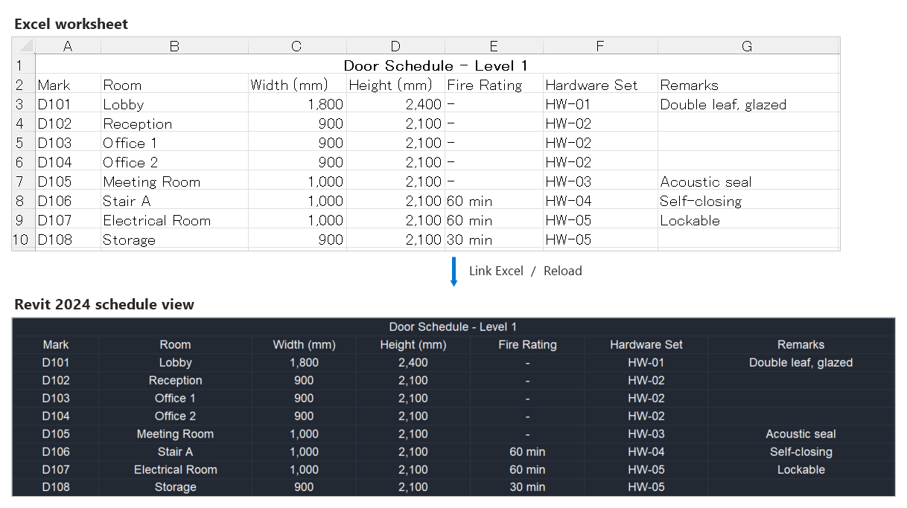

# Excel Schedule Link for Revit 2024

When vendors and subcontractors sent product schedules in Excel, such as door
hardware, fixtures, or equipment lists, I had to turn each file into a PDF and
link it into Revit. That was a pain, so I built this to draw the Excel table
directly in Revit. You can show an Excel worksheet inside Revit as a schedule
view and update it with one click when the workbook changes.

> **Status: Pilot (0.10.0).** Works with **Autodesk Revit 2024 only**. Try it on
> a copy of a project first, keep backups, and check results before you save or
> sync. This is a personal project maintained in spare time; there is no
> guaranteed support.

## What it does

- **Link Excel** — choose an `.xlsx` file and a worksheet, with an optional cell
  range. The first widths are calculated from Excel and the displayed text with
  a fixed 1.5 factor; there is no scale question. You get a schedule view that
  you can place on any sheet, print, and export to PDF.
- **Reload** — edit and save the workbook, then click once to rebuild the table
  in place. Sheet placements stay where they are.
- **Keeps Excel's look for numbers** — you keep thousands separators,
  percentages, dates, leading zeros, units like `12.3 A` or `1234 CFM`,
  fractions, and merged cells.
- **Column Widths and row heights** — use Fit Content, Distribute Evenly, Restore
  Excel Widths, Fit to Total, or enter exact widths in project units. With **Fit
  rows to text on reload**, the add-in sets header-row heights on Link, Reload,
  and every Column Widths Apply, including the ribbon Quick Layout tools. It can
  make rows taller or shorter. **Keep current row heights** disables text
  fitting; Apply leaves current heights alone, while Reload restores captured
  heights where possible and reports rows Revit could not keep. Wrapped text may
  still be hidden.
- **Link Manager** — see every link in the model in one six-column register,
  with source and integrity status, reload controls, and repair controls. Layout
  and reload policies are managed in Column Widths; Manager has no settings
  editor.
- **Read-only and careful** — the add-in never writes to your workbook. It can
  read a file while it is open in Excel. Workbook-based actions read the needed
  data before touching the model; Fit Content and Distribute use the current
  rendered table, while Restore Excel Widths reads the linked worksheet. It
  asks before contacting an unknown network server.

Not included (yet): copying fonts, colors, borders or row heights from Excel,
write-back to Excel, automatic reload on file change, `.xls`/`.csv`. Row heights
can be estimated from displayed text by the add-in when Fit rows to text is
selected; Excel's own row heights are not copied.

## Who it is for

Use it when you keep schedules, equipment lists, area tables, or load
calculations in Excel and need them on Revit sheets.

## Install

1. Go to **[Releases](../../releases)** and download
   `ExcelScheduleLink_v0.10.0.zip` from **Assets**. The green **Code → Download ZIP**
   button gives you the source code, not the add-in.
2. Right-click the ZIP → **Properties** → tick **Unblock** → **OK**.
3. Extract it and run `scripts\install-revit2024.ps1` (right-click → **Run
   with PowerShell**) with Revit closed.
4. Start Revit 2024 and look for the **Excel Schedule Link** ribbon tab.

The files are **not digitally signed**, so Windows may warn you. Details,
checksums and uninstalling: [docs/INSTALL.md](docs/INSTALL.md).

## Documentation

| Doc | For |
|---|---|
| [Quick Start](docs/QUICKSTART.md) | Install and link your first worksheet in five minutes |
| [Installation](docs/INSTALL.md) | Installing, updating, uninstalling, Windows warnings |
| [User Guide](docs/USER_GUIDE.md) | Every feature, limits, network workbooks, FAQ |
| [Troubleshooting](docs/TROUBLESHOOTING.md) | Fixes by symptom, and how to report a problem |
| [Pilot feedback](docs/PILOT_FEEDBACK.md) | Tell us how it went |

## Feedback and contributing

- **Bugs and ideas:** open an issue. Please do **not** attach client or project
  files — see [Reporting a problem](docs/TROUBLESHOOTING.md#reporting-a-problem).
- **Security issues:** report them privately — see [SECURITY.md](SECURITY.md).
- **Pull requests:** start with a short discussion in an issue. See
  [CONTRIBUTING.md](CONTRIBUTING.md).

## Building from source

If you are developing the add-in, see [docs/DEVELOPMENT.md](docs/DEVELOPMENT.md)
for building, testing, packaging and the architecture notes.

## License and trademarks

Released under the [MIT License](LICENSE). Third-party components are listed in
[THIRD-PARTY-NOTICES.txt](THIRD-PARTY-NOTICES.txt).

Autodesk and Revit are registered trademarks or trademarks of Autodesk, Inc.,
in the USA and/or other countries. Excel is a trademark of the Microsoft group
of companies. This project is independent and is not affiliated with,
sponsored by, or endorsed by Autodesk or Microsoft.
