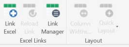
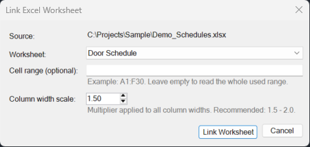

# Excel Schedule Link — Quick Start

Excel Schedule Link puts an Excel worksheet inside Revit as a schedule view.
Save the workbook, then reload the table with one click. That saves you from
copy-paste.

*Revit 2024 only. Installing takes about five minutes and needs no
administrator rights.*

> **Pilot release.** Try it on a copy of a project first, and keep backups.

---

## 1. Install (one time)

1. Download `ExcelScheduleLink_v0.9.3.zip` from the project's **Releases** page.
   Use the release ZIP, not the green **Code → Download ZIP** button. That
   button contains the source code.
2. **Before extracting:** right-click the ZIP → **Properties** → tick
   **Unblock** → **OK**. Skipping this is the most common reason for "nothing
   happens" later.
3. Extract the ZIP to any folder, for example `C:\Tools\ExcelScheduleLink`.
4. Close Revit. In the extracted folder, right-click
   `scripts\install-revit2024.ps1` → **Run with PowerShell**. Wait until the
   last lines turn green.
5. Start Revit 2024. Look for the new ribbon tab **Excel Schedule Link**.

   

Trouble? See [TROUBLESHOOTING.md](TROUBLESHOOTING.md), sections 1 and 2. More
detail on installing: [INSTALL.md](INSTALL.md).

## 2. Link your first worksheet

1. Open a practice model in Revit.
2. On the **Excel Schedule Link** tab, click **Link Excel**.
3. Choose your `.xlsx` file.
4. Choose the **worksheet**, leave **Cell range** empty (= the whole used
   range), and leave **Column width scale** at 1.5.

   

5. Click **Link Worksheet**. A new schedule view opens with your worksheet in it.

## 3. Get the column widths right

If the columns are too narrow or too wide, use the **Layout** panel on the same tab:

- **Quick Layout → Fit Content** sizes every column to its text in one click.
- **Column Widths…** lets you type exact widths (mm), or use Distribute Evenly,
  Restore Excel Widths or Fit to Total. **Apply** keeps the dialog open so you
  can try another layout.

## 4. Put it on a sheet

Drag the new schedule from the **Project Browser** onto a sheet, just like any
Revit schedule. It prints and exports to PDF normally.

## 5. When the Excel file changes

1. Edit and **save** the workbook in Excel. It can stay open.
2. In Revit, open the linked schedule view.
3. Click **Reload Link**. The table updates in place; your sheets do not need
   any changes.

---

- **Want more?** [USER_GUIDE.md](USER_GUIDE.md) covers ranges, column widths,
  network workbooks, the Link Manager and styling.
- **Something wrong?** See [TROUBLESHOOTING.md](TROUBLESHOOTING.md).
- **Tried it?** Feedback is welcome — see [PILOT_FEEDBACK.md](PILOT_FEEDBACK.md).
