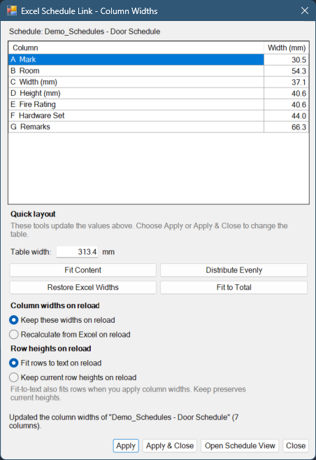
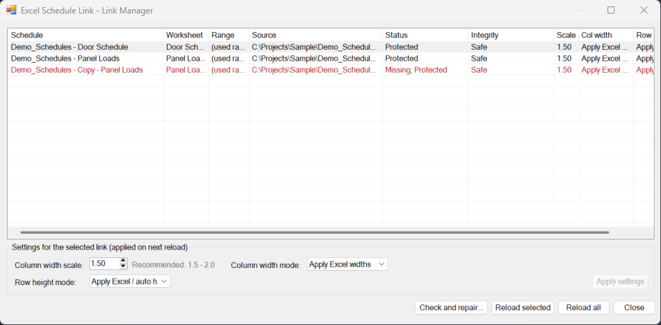

# Excel Schedule Link — User Guide

> **Pilot release (0.10.0), Revit 2024 only.** Try it on a copy of a project
> first, keep backups, and check the result before you save or sync. See
> [Before you start](#before-you-start).

## How it works

- **Link** lets you bring one Excel worksheet into Revit as a schedule view. The
  link (the file, worksheet and settings) is saved inside the Revit model.
- **Reload** reads the workbook again and rebuilds the table in place. Sheets
  that show the schedule keep their layout.
- The add-in only **reads** Excel. It never writes to your workbook. It reads a
  temporary copy, so the file can stay open in Excel.
- **Workbook-based actions** read the needed workbook data before changing the
  model in a single Revit transaction. Fit Content measures the table already
  rendered in Revit, Distribute Evenly uses the current widths (the dialog's
  candidates, or the live table from Quick Layout), and Restore Excel Widths
  reads the linked worksheet. A failure inside an open mutation
  transaction attempts a rollback and reports whether Revit confirmed it; a
  later check after commit can still report a failure without undoing the
  committed change. See
  [When something fails](#when-something-fails).

## Before you start

- **Revit 2024 only.** Other Revit versions will not load this build.
- **Pilot software.** It has been tested, but not on every kind of project.
  Use a copy or a throwaway model the first time.
- **Back up** the model before your first real use. Check the result before you
  save or synchronize.
- **Workshared models:** agree with your team before you link or reload
  schedules in a central model. Other people see the changes after you sync.
- **Unsigned files.** The DLLs and install scripts are not digitally signed.
  Windows may warn about them. See [INSTALL.md](INSTALL.md).

## Linking a worksheet

On the **Excel Schedule Link** ribbon tab, click **Link Excel**, then choose an
`.xlsx` file.

| Field | What it does |
|---|---|
| **Worksheet** | Choose which sheet of the workbook to show. |
| **Cell range** (optional) | For example `A1:F30` to show only that block. Leave it empty to use the whole used range. |

The add-in calculates the initial widths from Excel and the displayed text with
a fixed 1.5 factor. The Link dialog has no scale field. New links keep their
current column widths on later reloads. Existing links retain their saved width
policies and conversion factors, including older factors; factor editing is no
longer offered.

Click **Link Worksheet**. A new schedule view named `<workbook> - <worksheet>`
opens. You can rename it in the Project Browser like any other view. The link
stays with the schedule, not with its name.

The next time you use Link Excel, the folder, worksheet and range from your last
successful link are offered again. If the new workbook does not have that
worksheet, its first worksheet is selected instead.

**Already linked?** If the same workbook, worksheet **and** range are already
linked in this model, the add-in tells you and offers to open the existing
schedule. You can still create a second one. A **different range** of the same
worksheet counts as a new link, so you can split one worksheet across several
schedules.

### What comes across from Excel

| Excel feature | Shown in Revit? |
|---|---|
| Values, including formula results | Yes — the value Excel last saved (formulas are not recalculated) |
| Number formats: whole numbers, decimals, thousands separators, %, dates, times, leading zeros | Yes |
| Units inside custom formats (`12.3 A`, `12.35 kVA`, `1234 CFM`) and `$` prefixes | Yes |
| Fractions (`1 1/2`, `2 7/10`) | Yes, up to three-digit denominators |
| Merged cells | Yes |
| Column widths | Calculated from Excel and displayed text for a new link; adjust them in Column Widths or Revit |
| Scientific notation, elapsed time like `[h]:mm`, dates mixed with quoted text | Shown as plain values for now |
| Fonts, colors, borders, Excel row heights, images, charts | No — see [Styling the table](#styling-the-table) |

Excel row heights are not copied. When **Fit rows to text on reload** is selected,
the add-in estimates and sets each Revit header-row height on Link, on Reload,
and on every Column Widths Apply. It can make rows taller or shorter. If a row
cannot be fitted, the action still succeeds and reports that text may be hidden.

**Size limits.**

- A linked table shows at most **500 rows × 50 columns**. A bigger worksheet or
  range is not refused: the top-left 500 × 50 cells are shown, and a note tells
  you how big the source was.
- Only the worksheet you pick is read. Other sheets in the same workbook can be
  as large as you like.
- To protect Revit from broken or deliberately crafted files, a workbook is
  refused **before it is read** if it is bigger than 128 MB, or if its contents
  are far outside what Excel itself produces (for example a cell with more than
  32,767 characters, or coordinates beyond Excel's own grid). The message
  starts with *"The workbook exceeds the Excel Schedule Link safety limit
  for…"* and names the limit. Real project workbooks are well within these
  limits.

## Workbooks on a network server

Workbooks on a mapped drive (for example `Z:\Projects\...`) work like local
files.

For a network path that starts with `\\` (for example
`\\fileserver\projects\...`):

- **When you pick the file yourself** in Link Excel, that counts as your
  approval. You will not get an extra question.
- **When the path comes from the model** (Reload, Reload all, repairs,
  Restore Excel Widths) and you have not used that server before, the add-in
  first asks **"Allow access to \\fileserver?"** and shows the full path.
  **Cancel** is the default. Choose **Allow access** only if you trust the
  server. Reload all asks at most once per server.
- Your approval is remembered **for your Windows account on this computer**,
  not in the Revit model. A model you receive from someone else can never
  approve a server for you.
- Until you approve a server, Link Manager shows its links as
  `Network - not approved` and does not contact the server at all.
- Approved servers are listed in `%AppData%\ExcelScheduleLink\ui-settings.txt`
  on the line that starts with `ApprovedNetworkServers=`. To withdraw an
  approval, close Revit and remove the server name from that line.

This protects you from models that point at an unknown server. Simply
contacting a server can send it information about your Windows sign-in.

## Placing the schedule on a sheet

Drag the schedule from the Project Browser onto a sheet, just as you would for
any other Revit schedule. Printing and PDF export work normally.

- In the **schedule view** you can drag individual column widths.
- On a **sheet** you can only drag the table's overall width. That is normal
  Revit behavior.
- To set exact widths from anywhere, including a sheet, use the
  [Layout tools](#adjusting-column-widths).

## Adjusting column widths

The **Layout** panel works with the linked schedule that is open or selected,
including a schedule placed on a sheet.

### Column Widths…

This opens a dialog that lists every column:

| Part | What it does |
|---|---|
| **Column** | Shows the spreadsheet letter and a short heading, such as `B  Description`. The first eligible single-column non-blank cell supplies the heading; a title merged across columns is skipped. |
| **Width** | Type an exact width in the project units. Changed values must be from **30.5 to 609.6 mm** or **1.20 to 24.00 in**. A narrower width made by dragging in Revit is kept if you do not change it in this dialog. |
| **Fit Content** | Redistributes the current candidate total using the displayed text when that total is within the supported total-width range. Outside that range, it uses all-minimum or all-maximum column widths and warns that the total cannot be kept. Numbers and reference-like values are protected when possible; other text may wrap. Short merged cells and protected values that cannot stay on one line are reported. |
| **Distribute Evenly** | Gives every column the same width from the current candidate total. The total is kept when each equal share is within 30.5 to 609.6 mm (1.20 to 24.00 in); otherwise every column is set to that limit and the total changes. |
| **Restore Excel Widths** | Reads the current worksheet and applies the widths it has **now**. |
| **Table width / Fit to Total** | Shows the total in mm or inches. Fit Content preserves the current candidate total within the supported total-width range; outside that range it falls back to all-minimum or all-maximum widths and warns that the total cannot be kept. Fit to Total is the explicit way to widen or otherwise choose a new total. |
| **Reload policies** | Choose separately whether column widths are kept or recalculated from Excel, and whether row heights are fitted to text or kept. |

Fit Content, Distribute Evenly and Restore Excel Widths change candidates only.
Nothing changes in the model until you press one of these buttons:

- **Apply** — applies the widths and keeps the dialog open, so you can try
  another layout.
- **Apply & Close** — applies and closes.
- **Open Schedule View** — jumps to the schedule view (asks first what to do
  with changes you have not applied).
- **Close** — closes; asks first if you have changes you have not applied.

Widths are applied all together or not at all. If one column cannot be set,
nothing changes and the column is named in the message.

If a typed value is not a number, the cell is marked and the status line at the
bottom explains the problem and the allowed range. Apply waits until the marked
value is corrected. A changed width outside the allowed range is refused with
the range and the column's letter plus heading. A preserved native width that is
already narrower than the displayed range can remain unchanged.

### Row heights

With **Fit rows to text on reload**, the add-in sets every header-row height to
fit the displayed text on the initial Link, every Reload, and every Column Widths
Apply, including the ribbon Quick Layout tools. Fitting can shorten a previously
tall row as well as enlarge a short one. If a fitted row cannot be retained, the
action still succeeds and says **Text may be hidden in N row(s): the rows could
not be fitted to their text.** If fitting measurements are unavailable, it says
that rows could not be fitted because measurements were unavailable and asks you
to check for hidden text.

With **Keep current row heights**, text fitting is disabled. Apply leaves the
current row heights alone. During Reload, the add-in restores the captured row
heights where Revit allows; if it cannot keep a saved height, the reload reports
**Revit did not keep the saved height for N row(s).** Wrapped text may still be
hidden; choose Fit rows to text and apply, or adjust the row heights yourself.
Revit's own drag operation does not trigger fitting until the next add-in Apply
or Reload.

**Upgrading from 0.9.x:** links created with 0.9.x keep their saved settings.
Most use the row setting that 0.9.x showed as **Apply Excel / auto heights**,
which is now **Fit rows to text on reload**. The next Reload or Column Widths
Apply, including Quick Layout, therefore fits every header row to its text and
replaces row heights you adjusted by hand. To keep those heights, open **Column
Widths** before you reload, choose **Keep current row heights on reload**, and
press **Apply**. The dialog shows which row setting the link currently uses.

Fit Content is a width preview, so it does not set row heights until Apply. It
preserves the current candidate total only within the supported total-width
range. If the total is below or above that range, all columns use the minimum or
maximum supported width, and the status warns that keeping the total is not
possible; the resulting total is shown. Its comfortable-width figure is an
estimate and may be marked **(limited estimate)** when long text or maximum
column widths cap the calculation. It never shrinks, truncates or splits the
text. Inspect the result on the sheet, especially for merged cells and long
text.

Row fitting is an estimate calibrated on screen at **150% display scaling with
Arial**. Very long Latin prose can wrap one line more than estimated. Sheet and
PDF output has been checked for the tested tables, not for every font or table
size, and performance for a 500-row table has not yet been measured.

### Quick Layout

The **Quick Layout** dropdown applies *Fit Content*, *Distribute Evenly* or
*Restore Excel Widths* in one click, without opening the dialog. Fit Content
measures the displayed table and uses the live table total when it is supported;
Distribute Evenly uses the live current widths and total. Restore Excel Widths
reads the linked worksheet and uses its workbook-derived widths, so its total
can change. When Fit rows to text is selected, fitting happens in the same Apply
action.

### How layout and reload work together

- Column and row reload policies are stored by **Column Widths** and applied
  together with the current width change.
- Typing a width, using Fit Content, using Distribute Evenly, or using Fit to
  Total selects **Keep these widths on reload**. Quick Layout Fit Content and
  Distribute save that column policy immediately. The row-height policy remains
  separate and is not changed by this switch.
- *Restore Excel Widths* changes only the current widths. It leaves both reload
  policies unchanged.
- Fit Content preserves the current total within the supported total-width
  range. If the total is outside that range, it uses all-minimum or all-maximum
  widths and warns that the total cannot be kept. If the estimate says more
  width is comfortable, enter the displayed value under **Table width** and
  press **Fit to Total** to choose a wider supported total explicitly.

Changed widths are limited to roughly 1.2–24 inches per column, so very long
text may still wrap. A long title across the whole table can show **(limited
estimate)** rather than a merged-cell shortage because the estimate caps very
long text.

## Reloading after Excel changes

1. Save the workbook in Excel. It can stay open.
2. Open the linked schedule view, or select it in the Project Browser.
3. On the **Excel Schedule Link** tab, click **Reload Link**.

The result message tells you what happened: the workbook had not changed, or
the changed workbook was reloaded after you confirmed it. Sheet placements are
kept, and nothing is duplicated. If the rendered column count changed, the
message gives a limited hint to inspect the widths and try Fit Content or Restore
Excel Widths. A fixed range, a same-count substitution, or a capped 50-column
render can change the content without producing that hint.

If the workbook cannot be found at its saved path or next to the model where it
was found before, the reload says so and changes nothing. Put the file back, or
link the new location.

### When the workbook looks different

Each link remembers a fingerprint (SHA-256) of the workbook it last read.

- **Same fingerprint:** the reload normally goes ahead without asking you. If
  another user created the link (or Revit cannot tell who did) and its saved
  column policy recalculates widths from Excel, the independent width-risk check
  still asks for confirmation. Reload all skips that link instead of asking.
- **Different, and you created the link:** you get a normal "the workbook has
  changed — reload?" question.
- **Different, and someone else created the link (or Revit cannot tell who):**
  the question is stricter. **Cancel and locate the intended workbook** is the
  default. Choose **Reload this resolved workbook** only if you are sure it is
  the right file. This catches the case where the same path on your computer
  points to a different file than on a colleague's computer.

**Reload all** never answers these questions for you. Links that need a
decision are skipped and listed as **Confirmation required**, separately from
missing or failed links.

When the workbook bytes match, Reload all may process a link created by another
user if its saved column policy is Keep. For a link created by another user, or
whose creator is unknown, a saved policy that recalculates widths from Excel still
needs the independent width-risk confirmation, so Reload all skips that link.
Changed or unknown source identity still needs confirmation, so
Reload all skips that link.

In a workshared model, the first command that changes an Excel-linked schedule
shows a short reminder once per Revit session. It does not block anything.

### Links made with older versions

Links made with Excel Schedule Link versions before 0.9.1 appear in Link
Manager as **Legacy / identity unknown**. The first time you reload or apply a
layout to such a link, the add-in asks before upgrading it.
After the upgrade, older versions of the add-in can no longer reload or manage
that link (the table itself stays visible). Cancel leaves everything as it was.

## Unsafe schedule styles

Versions before 0.9.2 could save a linked table whose cells had no cell style.
Opening such a schedule view can make Revit 2024 close unexpectedly. The add-in
now checks every new, reloaded or rebuilt table before saving it. It also looks
for schedules that an older version already saved this way.

### When a model opens

The add-in checks the linked schedules. The check runs inside a transaction
that is rolled back, so it is not meant to leave any change in the model. It
covers up to 64 schedules and 100,000 header cells in total, and up to 25,000
header cells per schedule. Anything beyond these limits is shown as
`Not checked - do not open`.

If unsafe schedules are found in an editable model, you see
**Unsafe Excel-linked schedule styles were found.** with a list of schedules:

- **Do not open the listed views** from the Project Browser until they are
  repaired. The add-in cannot stop Revit's Project Browser from opening them.
- **Review repairs now** takes you through the schedules one by one. Choose
  **Reload from workbook** to repair, or **Skip this schedule**.
- **Not now** (the default), **Cancel**, or closing the dialog changes nothing.
  You can repair later from Link Manager.

A read-only model, or one with schedules marked `Not checked`, gets a message
without repair choices. Open an editable copy, or use **Check and repair...**
in Link Manager.

### Repairing

- **Reload from workbook** is the normal repair. It keeps the schedule, its
  name and its sheet placements, and shows the usual confirmations. If the
  repaired table passes the check, the result says **Unsafe cell styles were
  repaired.**
- **Reload all** also reloads unsafe links under the same rules, never asks
  per-link questions, and reports **Repaired: n**.
- **Rebuild from current table** is offered when one unsafe schedule's workbook
  cannot be found or read, or when you cancel the network-server approval for
  it. It rebuilds the schedule from the text and layout
  already stored in Revit, without Excel. Cell-specific formatting is replaced
  by the schedule's Appearance settings. You confirm it every time, and
  Reload all never uses it.

### What the add-in will not do

- It will not open an unsafe or unchecked schedule for you, from any dialog.
  It offers **Reload from workbook** instead.
- Repairs (the repair review and **Rebuild from current table**) refuse a model
  that is read-only or opened from a read-only file, unless it is a detached
  copy. Save an editable copy first. A normal reload is not affected.
- In a detached copy, repairs say **This repair changes the detached copy
  only.**
- In a workshared model, a schedule that another user has borrowed cannot be
  changed. Ask them to synchronize and relinquish it, reload latest, and try
  again.

## When something fails

- If the workbook cannot be read, nothing in the model is touched.
- If a failure occurs while a model-mutation transaction is open, the add-in
  attempts to roll it back. It says the change was rolled back **only when
  Revit confirms it**. Otherwise it says **Rollback completion could not be
  verified.** A reload or repair can also fail a final integrity check after its
  mutation has committed; that check can leave the committed change in the
  model and is not a transaction rollback. If rollback cannot be verified, or
  if Revit reports a regeneration failure, **close the model without saving**
  and open it again before you continue.
- If Revit reports a regeneration failure, the add-in stops work for that
  document session. It does not keep checking, reloading, repairing, or reading
  the document automatically after the failure. A change that had already
  completed before the failure remains; the failed action is not reported as
  successful. You see one add-in message, not a second Revit error box. Close
  the model without saving and reopen it before continuing.

## The Link Manager

On the **Excel Schedule Link** tab, click **Link Manager** to see and manage
your links.

- You see every linked schedule with its worksheet, range, source path and
  **Status**:
  - `Protected` — the link has a workbook fingerprint.
  - `Protected / identity unknown` — the first fingerprint is still pending.
  - `Legacy / identity unknown` — made with an older version and not upgraded.
  - `Missing` — the workbook cannot be found.
  - `Network - not approved` — the workbook is on a network server you have not
    approved yet. See [Workbooks on a network server](#workbooks-on-a-network-server).
  - `Invalid workbook path` — the saved path cannot be a usable `.xlsx` location.
    The add-in does not try to open it. Create a new link.
- **Integrity** shows `Safe`, `Unsafe - reload required` or
  `Not checked - do not open`. **Check and repair...** checks up to 256
  schedules and lets you approve each repair. See
  [Unsafe schedule styles](#unsafe-schedule-styles).
- **Reload selected** reloads the selected link using its saved policies.
  **Reload all** reloads every link that does not need a decision. Ordinary
  per-link failures are isolated, so they do not stop other links. A fatal Revit
  regeneration failure stops the batch, so later links are not processed.
  Manager has no settings editor or settings-save prompt.
- Use **Column Widths** to store the separate column-width and row-height reload
  policies. Those policies are applied atomically with a successful layout
  change. They do not change how direct dragging works in Revit or lift the
  changed-width range.

The window size and column layout are remembered between sessions.

## Styling the table

Excel fonts and colors are not copied. Use Revit's own tools to style the
schedule so it matches your office standards:

1. Select the linked schedule view.
2. In **Properties**, open **Appearance** (Edit...).
3. Set the text font, text size and grid lines like for any Revit schedule.
   These settings survive reloads.

Tip: style one linked schedule the way you like, then use it as the reference
for the others.

## Good to know

- **A small "A" strip under the table in the schedule view.** That is Revit's
  column letter for a hidden helper column. It never shows on sheets, prints or
  PDFs.
- **Keep "Show Title" on.** The table lives in the schedule's title area.
  Turning off *Show Title* in Appearance hides the whole table.
- **Moving files.** A link remembers the full path and a path relative to the
  model. Moving the project and the workbook together usually keeps the link
  working.

## FAQ

**Does the workbook need to be closed?**
No. Linking and reloading work while the file is open in Excel.

**Are formulas recalculated?**
No. Revit shows the values Excel last saved, so save the workbook after
editing.

**Can it write back to Excel?**
No. The link is one-way, Excel → Revit, on purpose.

**Old `.xls` files or `.csv`?**
No, only `.xlsx`.

**Do colleagues without the add-in see the table?**
Yes. The table is ordinary Revit content. They just cannot reload it.

**Non-English text?**
Sheet names, cell values and file paths in any language are supported,
including CJK text.

**Where do I report a problem?**
Open an issue on the project's GitHub page. See
[TROUBLESHOOTING.md](TROUBLESHOOTING.md#reporting-a-problem) for what to
include — and what not to attach.
